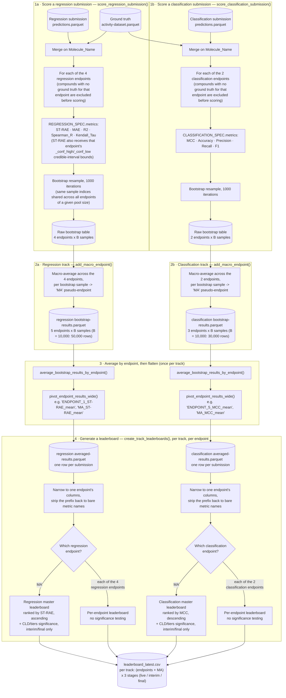

# Regression/Classification Scoring & Leaderboard Generation

How a regression or classification submission turns into bootstrapped per-endpoint
metrics, a macro-averaged "MA" score, and its own leaderboard shown on the
HuggingFace Space. Scope: regression and classification are two fully independent
tracks — separate S3 upload prefix, separate Lambda, separate validation, separate
scoring call — each mirroring how the structure track is already independent.

<!-- TODO: the endpoint counts below (4 regression, 2 classification) and the
     example endpoint names (ENDPOINT_1 …) assume the template's default config.
     Update them to match this challenge's REGRESSION_SPEC.endpoints /
     CLASSIFICATION_SPEC.endpoints in backend/config.py. -->
 They still score against the same shared ground-truth
dataset (the same compound set, just different columns): both `TrackSpec`s have `dataset="activity"`.
The structure track itself scores a single endpoint (`LDDT-PLI`/`BiSyRMSD`/`LDDT-LP`)
and skips the macro-averaging step entirely (stage 2 below), so it goes straight from
stage 1 into stage 3's pivot (still narrowed to its one endpoint, "structure") with no
per-endpoint loop, and `create_track_leaderboards` (stage 4) builds it exactly one
leaderboard instead of one per endpoint. See
[structure-scoring.md](structure-scoring.md) for how structure's stage 1 actually
works. See [phases-and-stages.md](phases-and-stages.md) for how the
"live"/"interim"/"final" stage referenced here relates to compound sets
(`live`/`hidden`/`all`) and the HF Space's `CURRENT_PHASE`.

## Key design points

- **Submission upload, scoring, and leaderboards are all three independent tracks.**
  Regression and classification each have their own S3 upload prefix
  (`REGRESSION_PATHS`/`CLASSIFICATION_PATHS`, `submissions/regression/...` /
  `submissions/classification/...`), own Lambda
  (`lambda_handler_regression.py`/`lambda_handler_classification.py`), and own
  validation schema (`submission_validation.get_regression_schema`/
  `get_classification_schema`) — mirroring the already-independent structure track.
  Both still score against the same shared ground truth (the `activity` dataset,
  `activity-dataset.parquet`/`activity-identifiers.parquet`) since they cover the same
  underlying compound set, just different columns. One valid submission produces
  exactly one manifest row, under its own track.
- **Regression and classification endpoints use different metric sets, dispatched per
  endpoint.** `score_activity_predictions(predictions, ground_truth, endpoints)` is
  called once per track with that track's own `endpoints` list (so bootstrap sample
  indices are shared across endpoints wherever pool sizes match — see below), and
  picks `REGRESSION_SPEC.metrics` (ST-RAE/MAE/R2/Spearman_R/Kendall_Tau) for a regression
  endpoint or `CLASSIFICATION_SPEC.metrics` (MCC/Accuracy/Precision/Recall/F1) for a
  classification endpoint via `_metrics_for_endpoint`.
- **`ST-RAE` (soft-thresholded RAE) needs each regression endpoint's credible-interval
  bounds.** Ground truth carries `f"{endpoint}{REGRESSION_CREDIBLE_INTERVALS_UPPER_SUFFIX}"`/
  `f"{endpoint}{REGRESSION_CREDIBLE_INTERVALS_LOWER_SUFFIX}"` columns (`..._conf_high`/
  `..._conf_low`) for every regression endpoint. `score_activity_predictions` pulls
  these alongside `y_true`/`y_pred` and passes them to `bootstrap_metrics`, which
  inspects each metric function's signature (`_metric_needs_credible_interval_bounds`)
  and only forwards the bounds to metrics that accept them — currently just `ST-RAE`.
  A prediction inside `[y_true_lower, y_true_upper]` scores zero error for that
  compound; outside the band, error is the distance to the nearest bound rather than
  to the raw point estimate. Classification endpoints have no such columns — `None` is
  passed through, which is harmless since no `CLASSIFICATION_SPEC.metrics` function needs
  them.
- **`add_macro_endpoint` appends the macro step.** It appends that track's own "MA"
  pseudo-endpoint via `compute_macro_bootstrap_results` when the track has more than
  one endpoint. Called once per track's own `score_activity_predictions` output.
- **Classification labels can be missing; predictions never can be.** A compound
  without a ground-truth label for an endpoint (regression or classification) is
  excluded from that endpoint's bootstrap sampling — the exclusion mask uses
  `pd.isna` (not `np.isnan`) so it works whether the ground-truth column ends up
  float, bool, or (once a NaN forces upcasting) object dtype after the merge. A
  missing *prediction* for a compound that does have ground truth is a hard error,
  not silently excluded — `submission_validation.get_regression_schema`/
  `get_classification_schema`'s `nullable=False` should already reject that at validation time, but
  `score_activity_predictions` raises `ValueError` too as a second line of defence.
- **Bootstrap indices are shared across endpoints wherever their pool sizes match.**
  `bootstrap_sampling()` is cached by `(dataset_size, n_samples)`, so every endpoint
  with the same number of ground-truth-eligible compounds reuses the exact same 1000
  resamples for a given submission — this is what makes it valid to combine those
  endpoints sample-by-sample when macro-averaging.
- **The "MA" pseudo-endpoint is not a real endpoint** — it's a derived row computed
  *within* each bootstrap sample from that track's other endpoints, then appended so
  the rest of the pipeline (stage 3 onward) can treat it identically to a real
  endpoint.
- **Every metric uses a plain arithmetic mean across endpoints**, including the two
  bounded correlation coefficients (`Spearman_R`, `Kendall_Tau`).
  Not a Fisher z-transform (`arctanh` → mean(z) → `tanh`): that suits combining
  several noisy estimates of the *same* correlation, but here the endpoints are
  different correlations, and `arctanh` blows up near ±1 (`arctanh(1 - 1e-7) ≈ 8.4`
  vs. `arctanh(0) = 0`). A near-perfect Spearman on one or two endpoints and ~0 on the
  rest would macro-average to ~0.99 instead of ~0.3, so a couple of easy endpoints
  would dominate the score. (Fisher's z doesn't apply to Kendall's tau at all.)
- **Endpoint-prefixed, then narrowed back down.** Each track's `averaged-results.parquet`
  stores *every one of that track's* endpoint stats in one wide row (e.g.
  `ENDPOINT_1_ST-RAE_mean`, `MA_ST-RAE_mean` for regression;
  `ENDPOINT_5_MCC_mean`, `MA_MCC_mean` for classification). Generating any one
  leaderboard narrows this back down to a single endpoint's bare columns
  (`ST-RAE_mean`, `MCC_mean`, …) — so the exact same `FinalLeaderboard` ranking/CLD
  code handles every track's master and per-endpoint leaderboards identically; only
  which columns get selected differs.
- **Every real endpoint gets its own leaderboard**, ranked on that endpoint's own
  metrics. Each track's master (`MA`) leaderboard is the only
  one in that track ranked on the macro-averaged score — regression's master ranks by
  `ST-RAE` (ascending, lower is better), classification's by `MCC` (descending, higher
  is better).
- **Significance testing and invalid-submission filtering apply only to each track's
  master leaderboard (or the track's one leaderboard, for a single-endpoint track like
  structure), and only for "interim"/"final" stages — never "live", and never the
  individual per-endpoint leaderboards of a multi-endpoint track.** Pairwise bootstrap
  comparisons are expensive, so this keeps the auto-generated live leaderboard cheap;
  see `create_track_leaderboards` in `backend/aws_leaderboards.py`.
- **Pairwise p-values use the `(r + 1) / (B + 1)` form** (`EntryComparison` in
  `backend/leaderboard.py`). Two entries' bootstrap results are paired on their shared
  `Sample` index; `r` is the smaller of the number of samples where one entry beats or
  ties the other and the number where it loses or ties (ties count for both sides, the
  conservative convention), and the two-sided p-value is `2 * (r + 1) / (B + 1)`,
  capped at 1. It is never exactly 0: with
  `BOOTSTRAP_SAMPLES = 10000` the smallest possible value is about 0.0002 (why 10,000:
  see the comment in `backend/config.py`). P-values are
  then compared against Benjamini-Hochberg-adjusted thresholds. Because the pairing is
  on the sample index, `BOOTSTRAP_SAMPLES` must not change while a challenge runs.
- **Leaderboard generation is one function regardless of track or endpoint count.**
  `create_track_leaderboards` builds one leaderboard per `TrackPaths.endpoints` entry,
  plus an additional `MA` master when there's more than one endpoint (a
  single-endpoint track like structure just gets that one leaderboard, which also
  doubles as the "master" for significance-testing purposes). A track with *zero*
  endpoints (`CLASSIFICATION_SPEC.endpoints = []`, e.g. before that track launches, or if
  it's ever pulled) returns `{}` immediately rather than attempting to build anything
  — `lambda_handler_leaderboard.py`'s `_TRACKS` dict also skips registering a
  zero-endpoint track in the first place, so this is belt-and-suspenders.

## How the Space shows a leaderboard

The Space reads each leaderboard CSV from S3 and shows it as a table:

- **Scores** show as "mean ± std" but sort by the mean, numerically. Sorting is
  in each column header's ⋮ menu. Headers show ↑/↓ for which direction is better
  (`METRIC_HIGHER_IS_BETTER`, and the spec's `higher_is_better` for the primary
  metric), and the primary metric's column is bold.
- **Shading** alternates between significance tiers on interim and final
  leaderboards, and marks the top three on the live leaderboard.
- **Precision** is set per stage in `hf_space/config.py`: `LEADERBOARD_SIG_FIGS`
  (2 significant figures on the live leaderboard, 3 on interim and final). On
  `ROUNDED_STAGES` (live) the sort values and the download are rounded too, so the
  browser never receives full-precision scores while the challenge is running.
- **Usernames** sort by the name shown, ignoring case. An anonymous entry shows
  its alias (searchable by the alias only) and isn't linked to the user's profile.
  Names longer than 24 characters are shortened, with the full name on hover.
- A track with several endpoints has an **endpoint picker** choosing between
  the macro-averaged leaderboard and each endpoint's own.
- Visitors can **search** by name, **filter** on proprietary data and open code,
  and **show or hide columns**. The significance tiers column shows where a
  leaderboard has one; other columns the Space doesn't list itself start hidden. A live refresh keeps these choices.
- **Download CSV** gives each score's mean and std in separate columns, so the
  file can be sorted by either in a spreadsheet: full precision on interim and
  final, rounded on live.

## Where this lives in the code

| Diagram stage | Function | File |
|---|---|---|
| 1. Bootstrap + raw metrics, per-endpoint metric dispatch | `score_activity_predictions`, `bootstrap_metrics`, `_metrics_for_endpoint`, `_metric_needs_credible_interval_bounds` | `backend/evaluate_predictions.py` |
| 2. Narrow to one track + macro-average across its endpoints | `add_macro_endpoint`, `compute_macro_bootstrap_results` | `backend/evaluate_predictions.py` |
| 3. Average by endpoint + flatten (once per track) | `average_bootstrap_results_by_endpoint`, `pivot_endpoint_results_wide` | `backend/evaluate_predictions.py` |
| Per-track pipeline: fetch, validate, score, save, manifest | `process_new_regression_submission`, `process_new_classification_submission`, `score_regression_submission`, `score_classification_submission` | `backend/aws_submission_processing.py` |
| 4. Narrow to one endpoint + rank | `create_track_leaderboards`, `_narrow_averaged_results_to_endpoint` | `backend/aws_leaderboards.py` |
| Ranking, CLD significance | `FinalLeaderboard`, `EntryComparison` | `backend/leaderboard.py` |
| Showing it in the Space | `load_leaderboard`; `LeaderboardTable`, `render_leaderboard_table` | `hf_space/leaderboards.py`; `hf_space/leaderboard_table.py` |
