# Structure Track Scoring

How a structure submission (a zip of predicted protein–ligand complex PDBs) turns into
per-compound pose-quality scores, bootstrapped uncertainty, and the structure
leaderboard. Companion to [scoring-and-leaderboards.md](scoring-and-leaderboards.md),
which covers the regression and classification (activity) tracks and the parts of the
pipeline (bootstrap resampling, endpoint-prefixed flattening, leaderboard generation)
shared by every track — this doc only covers what's specific to structure:
`score_single_structure` through `bootstrap_structure_metrics` in
`backend/evaluate_predictions.py`.

```mermaid
flowchart TD
    subgraph S0["0 · Submission format"]
        ZIP[("structures.zip<br/>STRUCTURE_DATASET_SIZE PDB files, one per compound<br/>exactly one ligand residue, named LIG<br/>(checked at validation)")]
    end

    subgraph S1["1 · Per-compound scoring — score_single_structure(), one call per compound"]
        ZIP --> LOAD["Load model + reference PDB via OST PDBPrep<br/>(fault_tolerant=True)"]
        LOAD --> SELECT["Select LIG heavy atoms<br/>(rname=LIG and ele!=H)"]
        SELECT --> COUNT{"Model LIG residues<br/>≠ 1?"}
        COUNT -->|yes| NAN1["NaN sentinel<br/>(all 3 metrics)"]
        COUNT -->|no| BONDS{"SMILES given, and both<br/>ligands match it?<br/>(ligand_bonds.ligands_from_pdb)"}
        BONDS -->|yes| SDF["Ligands rebuilt with the SMILES' bonds<br/>(false ring bonds removed), passed<br/>to OST as SDF with explicit bonds"]
        BONDS -->|no| GUESS["Keep the LIG selection<br/>(bonds guessed from distances)"]
        SDF --> SCORERS
        GUESS --> SCORERS["Run two independent OST scorers<br/>SCRMSDScorer -&gt; BiSyRMSD, LDDT-LP<br/>LDDTPLIScorer -&gt; LDDT-PLI<br/>(substructure_match=True, coverage_delta=0.1)"]
        SCORERS --> RECONCILE["Reconcile each scorer's independently-solved<br/>ligand assignment via 'chain.residue_number' keys<br/>(their integer indices aren't comparable)"]
        RECONCILE --> PAIRS{"Any LDDT-PLI pair<br/>found in SCRMSD's keys?"}
        PAIRS -->|no| NAN1
        PAIRS -->|yes| STATE{"SCRMSD state_matrix<br/>valid for that pair?"}
        STATE -->|no| PARTIAL["Record LDDT-PLI only<br/>BiSyRMSD, LDDT-LP -&gt; NaN"]
        STATE -->|yes| FULL["Record all 3 scores"]
        PARTIAL --> BEST
        FULL --> BEST["Pick best pair:<br/>sort by (-LDDT-PLI, BiSyRMSD), take first"]
        BEST --> PB["PoseBusters (dock config)<br/>predicted PDB split via SplitMolByPDBResidues<br/>LIG fragment -&gt; mol_pred, rest -&gt; mol_cond<br/>bond orders from ground-truth SMILES if it matches<br/>22 boolean checks"]
        PB --> PBCHECK{"Failed checks &gt;<br/>POSEBUSTERS_MAX_FAILURES?"}
        PBCHECK -->|yes| PBZERO["Override: LDDT-PLI=0, LDDT-LP=0<br/>BiSyRMSD=BISYRMSD_NAN_PENALTY<br/>(coverage stays 1.0 — OST scored it)<br/>failed check names recorded"]
        PBCHECK -->|no| PBPASS["Return OST scores unchanged"]
    end

    subgraph S2["2 · Per-submission scoring — score_structure_predictions()<br/>= score_compounds_raw() + apply_coverage_and_penalties(), once per submission"]
        PBZERO --> PERCOMPOUND["One row per compound<br/>skip if no matching ground truth"]
        PBPASS --> PERCOMPOUND
        PERCOMPOUND --> COVERAGE["coverage = 1.0 if LDDT-PLI not NaN else 0.0<br/>(recorded before filling)"]
        COVERAGE --> PENALTY["Fill NaN with worst-case penalties:<br/>LDDT-PLI, LDDT-LP -&gt; 0.0<br/>BiSyRMSD -&gt; BISYRMSD_NAN_PENALTY (20 Å)"]
        PENALTY --> PERCOMPOUNDDF[("per-compound-results.parquet<br/>one row per compound x (LDDT-PLI, BiSyRMSD, LDDT-LP, coverage)")]
        PERCOMPOUND --> PBFAILDICT[("pb_failures: molecule ID -&gt;<br/>failed PoseBusters check names<br/>(only zeroed compounds)")]
    end

    subgraph S3["3 · Per-set aggregation — aggregate_structure_scores(), once per compound set<br/>bootstrap_structure_metrics()"]
        PERCOMPOUNDDF --> PHASE["Keep the set's compounds<br/>(all, or identifiers' set == live / hidden)"]
        PHASE --> RESAMPLE["Resample compounds (rows) with replacement<br/>1000 iterations"]
        RESAMPLE --> MEAN["Per sample: plain mean of each metric<br/>across the resampled compounds<br/>(not a regression metric function, unlike activity)"]
        MEAN --> BOOTDF[("bootstrap-results.parquet<br/>1000 rows, Endpoint='Structure' always<br/>same Sample/Endpoint schema as activity")]
    end

    BOOTDF --> BYEP["average_bootstrap_results_by_endpoint()<br/>mean &amp; std over the 1000 samples<br/>(shared helper, reused from activity)"]
    PERCOMPOUNDDF --> COVMEAN["coverage_mean = per-compound coverage.mean()<br/>added directly — coverage is scalar,<br/>not bootstrapped"]
    BYEP --> PIVOT["pivot_endpoint_results_wide()<br/>one wide row, prefixed 'Structure_...'<br/>(shared helper, reused from activity)"]
    COVMEAN --> PIVOT
    PIVOT --> WIDESAVE[("averaged-results.parquet")]

    WIDESAVE --> LB["create_track_leaderboards()<br/>one leaderboard, ranked by LDDT-PLI descending<br/>(no macro-average — only one endpoint, 'Structure')"]
```

## Submission-level QA (not per-compound scoring — `process_new_structure_submission`)

A submission's structures are scored once (`score_structure_predictions`, the
expensive OST and PoseBusters step). Each compound set's scores (see
[phases-and-stages.md](phases-and-stages.md)) are then a cheap re-aggregation of those
per-compound scores (`aggregate_structure_scores`: filter to the set's compounds,
bootstrap, average).

The coverage of all the compounds is used to classify the whole submission:

- **All compounds failed** (`coverage == 0` everywhere) → the submission is marked
  invalid outright (`"Scoring failed for all structures, please check submission"`),
  and no scores are saved.
- **Some compounds failed** → `validation_result.scoring = "partial"`, and the failed
  `Molecule_Name`s are recorded — the submission still gets a leaderboard entry (the
  failed compounds contribute their worst-case-penalty scores, per above), just with a
  partial-scoring flag surfaced to the participant.
- **No failures** → `validation_result.scoring = "complete"`.

## Key design points

- **Two OST scorers, reconciled post-hoc.** `SCRMSDScorer` (BiSyRMSD, LDDT-LP — pose
  RMSD / local-contact metrics) and `LDDTPLIScorer` (LDDT-PLI — protein-ligand
  interaction accuracy) each solve their own chain-mapping and ligand-assignment
  problem independently; that's an OST library constraint, not a choice made in this
  repo. When a complex has multiple equivalent ligand copies, the two scorers'
  internal integer indices are not guaranteed to refer to the same physical ligand, so
  `score_single_structure` builds a stable `"{chain}.{residue_number}"` key for each
  ligand and joins the two scorers' results on that instead. LDDT-PLI's assignment is
  treated as the source of truth for *which* pairs to report; a pair present in
  LDDT-PLI's assignment but missing from SCRMSD's ligand list is skipped (logged, not
  scored) — see the `RECONCILE`/`PAIRS` steps in the diagram.
- **A failed match doesn't drop the compound.** Even when a compound can't be scored
  at all (bad PDB, no ligand match, LDDT-PLI ↔ SCRMSD assignment mismatch,
  a model without exactly one LIG residue), it still gets a row with worst-case penalty values
  (`LDDT-PLI`/`LDDT-LP = 0.0`, `BiSyRMSD = BISYRMSD_NAN_PENALTY`), not an exclusion —
  the same principle activity scoring follows for a metric that fails on a bootstrap
  sample: a real failure should read as a bad score, not silently vanish from the
  average. `coverage` is recorded before this fill so the failure rate itself is still
  visible on the leaderboard/CSV.
- **Ligand bonds come from the ground-truth SMILES when they can.** Every ligand is
  a residue named `LIG`, which isn't in OST's compound library, and prediction tools
  write no `CONECT` records, so OST guesses the ligand's bonds from atom distances.
  Across a strained ring (azetidine, cyclobutane, some five-membered aromatics) the
  two atoms opposite each other can sit inside OST's bonding cutoff (about 2.08 Å for
  carbon), so a bond that doesn't exist is added. If that happens in one structure
  but not the other, the ligand graphs don't match, both scorers find no assignment
  and the compound is unscoreable; a reference with the false bond makes it
  unscoreable for everyone. With a `SMILES` column in
  `structure-identifiers.parquet`, `ligands_from_pdb` (`backend/ligand_bonds.py`)
  reads each `LIG` residue with RDKit, matches its heavy atoms to the SMILES, removes
  any stretched extra bond (one longer than 1.15 × the two atoms' covalent radii) and
  assigns the SMILES' bond orders. OST then gets the ligands as SDF, with explicit
  bonds. Both the model and every reference copy are rebuilt, or none is: mixing a
  SMILES-derived graph with a guessed one would bring the mismatch back. If anything
  doesn't match (no SMILES, a different atom count, an extra bond of normal length,
  which means the ligand isn't that compound), scoring falls back to the guessed
  bonds, so no compound scores worse than without SMILES. For ligands without
  strained rings the scores are identical either way.
- **Bootstrapping is a plain per-compound resample-and-mean**, not per-sample metric
  functions like activity's `bootstrap_metrics` — there's no y_true/y_pred pair to feed
  a metric function; `score_single_structure` has already reduced each compound down
  to three scalar scores, so the bootstrap just resamples *which compounds* go into
  each sample's mean.
- **Coverage is scalar, not bootstrapped.** It's a property of the whole submission
  (fraction of compounds successfully matched), not a distributional quantity per
  bootstrap sample, so it's computed once and appended directly to `averaged_df`
  (`coverage_mean`) rather than flowing through the bootstrap table.
- **`Endpoint` is `STRUCTURE_SPEC.endpoints[0]` (`"structure"`)** for every bootstrap row,
  which lets `average_bootstrap_results_by_endpoint`/`pivot_endpoint_results_wide`
  (built for activity's per-endpoint schema) work unchanged for structure's single
  endpoint. There is no macro-average pseudo-endpoint for structure (see
  [scoring-and-leaderboards.md](scoring-and-leaderboards.md) — a single-endpoint track
  never gets one), and `STRUCTURE_SPEC.endpoints[0]` is also the leaderboard's one and only
  endpoint slug. Before v0.1.1 the label was a hard-coded `"Structure"`, which didn't
  match the config and broke every structure leaderboard build. Leaderboard building
  matches endpoints case-insensitively, so score files saved with the old label still
  work.
- **Ranked by `LDDT-PLI` descending** (`STRUCTURE_SPEC`: `primary_metric="LDDT-PLI"`,
  `higher_is_better=True`) — higher is better, like classification's `MCC` but
  unlike regression's `ST-RAE` (lower is better, ascending).
- **PoseBusters filters geometrically or physically invalid poses after OST scoring.**
  After the best OST result is selected, the predicted complex PDB (`model_path`) is
  re-parsed with RDKit and split into fragments via `Chem.SplitMolByPDBResidues`; the
  `LIG` fragment becomes `mol_pred` and the remaining (protein) fragments are combined
  into `mol_cond`, so ligand and receptor stay in the same coordinate frame as the
  prediction. When the ground-truth SMILES matches the ligand, PoseBusters gets the
  same SMILES-bonded ligand as OST (see above). RDKit's PDB parser otherwise leaves
  every bond single, which causes false failures on geometry and energy checks: a
  benzene read with single bonds fails the non-aromatic ring flatness check, for
  example, and with `POSEBUSTERS_MAX_FAILURES = 0` that zeroes the pose. Before
  v0.2.0 the backend never passed the SMILES, so this applied to every compound. `PoseBusters(config="dock")` then runs 22 boolean checks covering ligand
  chemistry (sanitization, InChI convertibility, no radicals), geometry (bond lengths,
  angles, ring flatness, internal energy), and protein context (protein-ligand
  distance, steric clashes, volume overlap). If the number of failed checks exceeds
  `POSEBUSTERS_MAX_FAILURES` (default 0 — must pass all), the OST scores are
  overridden with worst-case values. These poses still count as covered
  (`coverage=1.0`) because OST scored them — the zeroing is a quality filter, not a
  parsing failure. PoseBusters is imported lazily inside the same `try` block as OST;
  if RDKit can't parse the predicted PDB, finds no `LIG` fragment, or PoseBusters
  itself raises, the outer handler returns the NaN sentinel (treated as unscored,
  `coverage=0`) — except the two "no LIG"/"unparseable" cases, which fall back to
  returning the OST scores unchanged rather than failing the whole compound.
- **Failed PoseBusters checks are surfaced, not just applied silently.**
  `score_structure_predictions` returns `(per_compound_df, pb_failures)` where
  `pb_failures` maps molecule ID to the sorted list of check names that failed.
  `process_new_structure_submission` stores this on `validation_result.pb_failures`
  (for all compounds), and `discord_bot.prepare_discord_message` reports it — an otherwise
  valid submission with PoseBusters failures gets an orange (not green) message
  listing which compounds and checks failed, so organisers can tell "scored poorly"
  apart from "structurally implausible."
- **`dummy_score_single_structure`** (random scores, no OST dependency) exists in
  `evaluate_predictions.py` but is **not currently called anywhere** —
  `score_structure_predictions` always calls the real `score_single_structure`. Real
  OST scoring is imported lazily inside `score_single_structure`'s `try` block (not at
  module load time), so importing `evaluate_predictions` doesn't require OST to be
  installed — only actually scoring a structure does.
- **One model ligand, any number of reference copies.** Validation rejects a
  submission unless every file has exactly one `LIG` residue (see
  `backend/README.md`'s Structure submissions section), and the scorer returns the NaN
  sentinel for a model without exactly one, as defence in depth. Otherwise the
  best-pair selection would score the best of several submitted poses. The
  *reference* may contain several copies of the ligand (symmetry mates, multiple
  sites): OST scores the one model ligand against each and the best match is kept.
  Alternate locations within one residue count as one ligand, and altloc A is scored.
  The PoseBusters check also relies on the `LIG` naming convention: if RDKit
  can't parse the predicted PDB, or splitting it finds no `LIG` fragment, PoseBusters
  is skipped and the OST scores are returned unchanged (logged as a warning) rather
  than failing the compound.

## Where this lives in the code

| Diagram stage | Function | File |
|---|---|---|
| 1. Per-compound scoring | `score_single_structure` | `backend/evaluate_predictions.py` |
| Ligand bonds from SMILES | `ligands_from_pdb`, `assign_bond_orders_from_template`, `ost_ligand` | `backend/ligand_bonds.py` |
| SMILES lookup from the identifiers | `structure_smiles_map` | `backend/aws_submission_processing.py` |
| 2. Per-submission scoring | `score_structure_predictions` (`score_compounds_raw` + `apply_coverage_and_penalties`) | `backend/evaluate_predictions.py` |
| 3. Per-set aggregation | `aggregate_structure_scores`, `bootstrap_structure_metrics` | `backend/aws_submission_processing.py`, `backend/evaluate_predictions.py` |
| S3 orchestration, submission-level QA | `process_new_structure_submission` (`score_structure_submission` is a one-set convenience wrapper) | `backend/aws_submission_processing.py` |
| Zip extraction (submission + ground truth) | `fetch_structure_submission_data`, `load_structure_ground_truth`, `_extract_pdb_files` | `backend/aws_submission_processing.py` |
| Submission-time validation (file count, `.zip` suffix) | `validate_structure_submission` | `backend/submission_validation.py` |
| PoseBusters failure reporting (Discord) | `prepare_discord_message`, `_format_pb_failures` | `backend/discord_bot.py` |
| Leaderboard generation | `create_track_leaderboards` | `backend/aws_leaderboards.py` |
